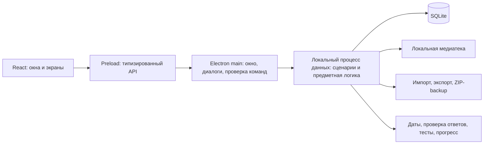

# Технический проект: архитектура и стек

Дата: 31 октября 2026 года.

Статус: архитектурное решение согласовано пользователем; создана рабочая сборка разработки. Фактическая реализация, проверки и ограничения перечислены в implementation-status.md. Целевая платформа подтверждена пользователем: Windows 10/11 x64, Intel/AMD.

## 1. Основное решение

Предлагается устанавливаемое Electron-приложение с React-интерфейсом, отдельной локальной службой данных внутри приложения и SQLite. Внешний сервер, браузер пользователя, учётная запись и подписка для повседневной работы не нужны.

Это модульное приложение в одном репозитории и одном установщике. Отдельные микросервисы, серверная СУБД, Docker и веб-хостинг не требуются.



Границы процессов скрыты от пользователя: запуск через один ярлык открывает одно приложение.

## 2. Стек и причины выбора

| Задача | Предложение | Причина |
| --- | --- | --- |
| Desktop | Electron | Windows-установщик, файловые диалоги, доступ к локальному хранилищу, управляемая версия Chromium |
| Интерфейс | React + TypeScript | Сложные формы, библиотека, состояния теста и переиспользуемые компоненты с проверяемыми контрактами |
| Сборка | electron-vite + Vite | Раздельные сборки main, preload и renderer; быстрый цикл разработки |
| Стили | CSS с дизайн-токенами | Контроль типографики, цветов и состояний; без тяжёлой декоративной темы |
| Поведение компонентов | Radix UI | Доступные диалоги, меню и focus-поведение с собственным визуальным оформлением |
| Конспекты | Tiptap | Форматированный документ, заголовки, списки и локальные изображения; хранение версионированного JSON документа |
| Формы и границы | Zod | Проверка IPC-команд, импорта, настроек и содержимого версионированных структур во время выполнения |
| База | SQLite через better-sqlite3 | Транзакции, связи, индексы, миграции, полнотекстовый поиск и согласованный backup без отдельного сервера |
| Изображения | sharp в процессе данных | Реальное декодирование, проверка формата и размеров, миниатюры и локальные копии |
| Графики | Recharts | Интерактивные графики по рассчитанным данным; вычисления находятся вне компонентов графика |
| ZIP и CSV | archiver + yauzl; csv-parse/csv-stringify | Потоковая работа с архивами, контролируемое извлечение и корректные табличные форматы |
| Проверки | Vitest; интеграционный запуск в Electron; Playwright | Отдельные проверки чистой логики, настоящей БД/файлов и пользовательских сценариев |
| Установщик | electron-builder, NSIS x64 | Установка для текущего пользователя и воспроизводимая упаковка под Windows |

Состояние навигации и временных форм живёт в React. Сохранённые сущности и результаты принадлежат процессу данных. Не дублировать базу в localStorage или браузерном состоянии.

### Почему этот вариант

- Tauri уменьшил бы размер дистрибутива, но добавил бы Rust, отдельный язык для системной части и зависимость интерфейса от WebView2. Для этого проекта преимущество Electron — единый TypeScript-контракт и предсказуемое поведение интерфейса. Цена — более тяжёлый дистрибутив и большее потребление памяти.
- .NET/WPF хорошо подходит для Windows, но требует отдельной реализации интерфейса и предметной части на C#. Текущая Linux-среда не даёт проверки Windows UI; преимущества React для редактора и аналитики здесь полезнее.
- Локальное веб-приложение не соответствует выбранному пользователем формату установки и запуска.

### Версии и воспроизводимость

В текущей среде установлены Node 24.19.0 и npm 11.9.0. Реестр npm на момент исследования сообщил Electron 45.2.1, electron-vite 6.0.0, better-sqlite3 13.0.3 и electron-builder 26.18.0. Метаданные этих пакетов не противоречат версии Node в среде.

Сочетание закреплено в package-lock.json и проверено в Linux: npm ci, реальный runtime Electron, SQLite, изображения и оконные сценарии. Эти проверки не подтверждают Windows-пакет. При обновлении зависимостей совместимость проверяется повторно, а не только по engines.

## 3. Ответственность процессов

### Renderer

Экраны, формы, подтверждение ответа, состояние фокуса, графики и доступность. Нет прямого доступа к БД, файловой системе, сетевым секретам и произвольным IPC-каналам.

Renderer показывает только реальные данные или честные состояния «пока нет материала», «нет попыток», «не удалось прочитать изображение». Ошибки операции не подменяются успешным уведомлением.

### Preload

Узкий API через contextBridge: например, получить страницу библиотеки, создать объект, отправить ответ или выбрать файл. У каждого метода типизированные вход и выход. ipcRenderer и произвольный invoke наружу не экспортируются.

### Electron main

Жизненный цикл окна и приложения, одиночный экземпляр, системные диалоги, маршрутизация проверенных команд и выдача локальных ассетов. Проверяются источник IPC-запроса и его схема. Используются contextIsolation, sandbox, отключённый nodeIntegration и ограничительная CSP.

Произвольная навигация, запуск внешних команд и доступ по переданному из UI абсолютному пути не являются возможностями API. Импорт изображений работает с выбранными файлами и проверяемыми байтами.

### Процесс данных

Один долгоживущий utility process владеет соединением SQLite и очередью записей. В нём работают сценарии библиотеки, движок тестов, проверка ответов, прогресс, аналитика, медиатека и backup. Отдельный процесс нужен, чтобы массовый импорт, декодирование изображений и архивирование не блокировали управление окном.

Потеря процесса не превращает незавершённую операцию в успех: вызывающая сторона получает ошибку; при перезапуске проверяется журнал незавершённых файловых операций. Создание БД и ошибки открытия не должны молча приводить к появлению новой пустой базы вместо старой.

## 4. Модульные границы

Чистая предметная логика не импортирует Electron, SQLite, React или файловую систему:

- `dates`: разбор, нормализация, сравнение и отображение исторических дат;
- `answer-validation`: стратегии проверки и основания результата;
- `quiz-engine`: выбор материала, построение вопросов и состояния сессии;
- `progress-engine`: окно из 20 проверок, направления, уровни и агрегирование;
- `analytics`: показатели и ряды для графиков.

Сценарии приложения соединяют эти модули с репозиториями хранения. UI вызывает сценарий, а не выполняет запрос SQL и не повторяет формулу знания.

Новые типы заданий добавляются через внутренний реестр: идентификатор типа и версия, требования к данным, генератор вопроса, схема ответа, валидатор и компонент представления. Реестр не исполняет произвольный код из импортированного материала. Неизвестный тип выдаёт понятную ошибку совместимости, а не теряет данные молча.

## 5. Поток тестирования

1. Конструктор проверяет отбор материала, доступные направления и число вопросов. Если данных не хватает для вариантов ответа, это сообщается до старта; выдуманные исторические варианты не создаются.
2. Служба данных сохраняет сессию и неизменяемые снимки вопросов, ожидаемых ответов, политики проверки и связанных ассетов.
3. UI получает вопрос без эталона и оценки. Правильность не раскрывается до завершения теста.
4. Первый Enter переводит поле в подтверждение. Исправление текста не создаёт новую попытку и не запускает новый цикл подтверждений. Второй Enter отправляет окончательный текст с идентификатором команды.
5. Одна транзакция фиксирует попытку и доступную автоматическую оценку. Повторная доставка той же команды возвращает тот же результат и не добавляет вторую попытку.
6. После завершения открывается разбор. Самопроверка и неоднозначные случаи оцениваются здесь; до оценки им не назначается выдуманный балл.
7. Оценённые проверки обновляют прогресс по согласованной формуле. История и результаты сохраняются до перехода к следующему вопросу/экрану, а не только в памяти React.

Состояния на уровне хранения различают выполнение теста, ожидание разбора и завершение разбора. После обычного перезапуска ранее зафиксированные ответы остаются доступны. Техническое восстановление незавершённой сессии не должно заново засчитывать её ответы.

## 6. Проверка открытых ответов

Результат валидатора — `correct`, `partial`, `incorrect` или `needs_review` с объяснением и версией правил. Числовой балл возникает только у первых трёх результатов или после решения пользователя.

Для дат используется структурный разбор, а не нечёткое сравнение строк. Год вместо полной даты даёт 0,5; неверный указанный день не становится «просто неполной датой». Римские века, эра и интервалы нормализуются отдельно.

Для текста сначала проверяются нормализация и явные допустимые варианты. Нечёткое совпадение не отменяет различие чисел, имён, отрицаний или обязательных смысловых пунктов. Неоднозначное сходство фамилий передаётся на разбор; универсальная безошибочная семантическая проверка не обещается. Пользователь может добавить проверенную формулировку в допустимые ответы.

Для развёрнутого вопроса критерии содержат отдельные обязательные пункты и допустимые формулировки. Автоматический результат возможен только при достаточных заданных правилах; остальные случаи идут на самопроверку. Внешняя AI-служба не нужна для первой версии.

## 7. Данные, файлы и обновления

Постоянный каталог определяется через стабильный `app.getPath('userData')`, с именем приложения HistoryTrainer. На Windows это каталог данных пользователя, отдельно от установленной программы. В UI можно открыть расположение данных через настройки, без необходимости знать его структуру.

```text
<userData>/
  storage/
    active.json
    generations/<id>/
      library.sqlite
      media/<sha256>.<ext>
  backups/
  staging/
  logs/
```

`active.json` указывает на действующий комплект базы и медиатеки. Идентификатор поколения — технический способ переключить согласованный комплект при восстановлении, без частично восстановленных данных. Кэш интерфейса и миниатюры можно пересоздать; оригинальные файлы и БД — нельзя.

SQLite: внешние ключи включены, WAL, подготовленные запросы, транзакции записей и явная обработка ошибок диска. Миграции имеют номер и контрольную сумму. Перед миграцией создаётся проверенная копия; неудачная миграция не уничтожает исходное поколение. Автоматического downgrade базы нет.

SQLite — источник истины. Пересчитываемые показатели хранятся как проекции с версией алгоритма; их можно восстановить по попыткам и настройкам направлений. Исторические снимки ответов не перезаписываются из-за изменения текста карточки.

### Работа с изображениями

Импорт: получить файл → проверить фактический формат → декодировать с ограничением размеров → вычислить SHA-256 → сохранить локальный оригинал → зафиксировать ссылку в БД. Миниатюры отделены от оригиналов. Форматы первой реализации: JPEG, PNG и WebP; остальные не признаются поддержанными без декодера и тестов.

Файлы именуются по содержимому, а не по небезопасному исходному имени. Одинаковое изображение может использоваться разными объектами. Диагностика проверяет наличие, хеш, возможность декодирования и ссылки. Повреждённый файл и отсутствующая запись различаются.

Чтение для UI идёт по локальному протоколу и ID ассета, без произвольного абсолютного пути. Сетевые URL не являются постоянным источником отображения. Загрузчик по ссылке, если понадобится при подготовке ассетов, сначала получает и проверяет файл; не превращается в hotlink.

### Согласованность БД и файлов

Транзакция SQLite не может атомарно охватить файловую систему. Поэтому импорт сначала создаёт проверенный неизменяемый файл, затем транзакционно создаёт ссылки. Сбой между шагами может оставить неподключённый файл, но не ссылку на ещё не сохранённый файл. Неподключённые файлы убираются контролируемой очисткой после проверки активных операций и backup.

Удаление ссылки не удаляет файл, пока есть другие ссылки или операция резервного копирования. Физическое удаление — отдельная возобновляемая операция.

## 8. Backup и восстановление

Backup — согласованный SQLite-снимок плюс все связанные с ним оригинальные ассеты и манифест. В начале фиксируются операции записи и перечень ассетов; SQLite копируется через backup API, а не простым копированием открытого `.sqlite` без WAL. Удаление включённых файлов запрещено до окончания упаковки.

```text
backup.zip
  manifest.json
  library.sqlite
  media/<sha256>.<ext>
```

Манифест содержит версии формата и схемы, версию приложения, время создания, перечень файлов, размеры и SHA-256. В архив не попадают кэш, временные файлы, логи и секреты. При утрате файла backup считается неуспешным; неполный архив не объявляется корректной копией.

Восстановление:

1. Проверить манифест, совместимость версии, ограничения числа и суммарного распакованного размера файлов.
2. Отклонить абсолютные пути, выход из каталога, ссылки, дубликаты и опасные Windows-имена. Содержимое не исполняется.
3. Распаковать в отдельный staging-каталог. Проверить хеши, SQLite integrity/foreign key checks и декодирование изображений.
4. Создать и проверить предварительный backup текущей базы. Если он не получился, не заменять рабочую базу.
5. Подготовить новое поколение; при необходимости мигрировать его копию до текущей схемы.
6. Закрыть соединения к старому поколению и переключить `active.json` атомарной заменой на том же диске. Сохранить предыдущее поколение для восстановления после сбоя.
7. Открыть новое поколение и повторно проверить доступность. Сбой до переключения оставляет рабочим старое; сбой после переключения диагностируется при старте и допускает возврат к сохранённому поколению.

Не обещать абсолютную защиту от физической неисправности диска. Механизм защищает от типовых прерываний операции и проверяется fault-injection тестами на границах шагов.

## 9. Навигация и UX

Постоянная боковая навигация: «Главная», «Библиотека», «Тестирование», «Ошибки», «Статистика», «Медиатека», «Настройки».

Темы и конспекты доступны в дереве библиотеки; добавление, редактирование и массовый импорт — её рабочие маршруты. Конструктор и сессия находятся в тестировании. Backup и обмен данными находятся в настройках. Так все требуемые возможности доступны без четырнадцати конкурирующих пунктов меню.

В тесте интерфейс сфокусирован на вопросе, ответе, подтверждении и позиции в сессии. Результаты скрыты до завершения. Итоговый разбор позволяет пройти по всем вопросам и отдельно по ошибкам или ожидающим оценки.

Дизайн строится на нейтральных тёмных поверхностях, сдержанных акцентах, типографике и смысловых состояниях. Графики получают реальные наборы данных. Поддерживаются видимый focus, работа без мыши и reduced motion; анимация не блокирует ввод.

## 10. Сборка и проверка платформы

### В Linux-среде

Подтверждено наличие Node/npm, Python, g++ и make; доступны память и место для сборки. Зависимости установлены и повторно проверены через npm ci. Xvfb подготовлен локально для оконных проверок; Rust, .NET и Wine не требуются для текущих Linux-проверок.

Здесь можно готовить TypeScript, проверять чистую логику, собирать renderer и выполнять Linux-интеграцию SQLite/файлов. Оконные E2E и запуск Vite/Electron проверены на подготовленном виртуальном дисплее. Это не подтверждение Windows-релиза.

### В Windows

Нативные модули better-sqlite3 и sharp должны соответствовать целевой ОС, архитектуре и Electron runtime. Не использовать Linux-бинарники в Windows-пакете. Упаковка NSIS и проверка установки выполняются на Windows x64 runner/машине. Windows 10 и Windows 11 проверяются отдельными сценариями; одна Windows-машина не подтверждает автоматически обе системы.

Уточнение после проверки стека: better-sqlite3 13 использует Node-API и поставляет prebuilds. Для закреплённых better-sqlite3 и sharp принудительная ABI-пересборка не нужна; npmRebuild отключён, postinstall проверяет реальное открытие SQLite и декодер в Electron. Чистые тесты выполняются в Node, интеграционные — отдельной точкой входа в Electron. Смена версий требует повторной проверки совместимости.

Установщик проверяется на установку, запуск, повторный запуск, обновление с сохранением данных, русский текст в путях и работу backup. Windows-исполнение в текущей Linux-среде не доступно; наличие собранных JS-файлов не считается подтверждением Windows-релиза.

Подписывание установщика и автоматическое распространение не являются уже настроенными возможностями. Для личного тестирования допустим явно обозначенный неподписанный установщик; не заявлять проверенную подпись или настроенный автоапдейт.

## 11. Источники технических решений

Проверены официальные материалы и метаданные, 31 октября 2026 года:

- [Electron: поддерживаемые платформы](https://github.com/electron/electron#platform-support).
- [Electron: изоляция и безопасность](https://github.com/electron/electron/blob/main/docs/tutorial/security.md).
- [Electron: нативные Node-модули](https://github.com/electron/electron/blob/main/docs/tutorial/using-native-node-modules.md).
- [better-sqlite3: backup API](https://github.com/WiseLibs/better-sqlite3/blob/master/docs/api.md#backupdestination-options---promise).
- [electron-builder: упаковка и нативные зависимости](https://github.com/electron-userland/electron-builder#readme).
- Метаданные npm для electron, electron-vite, better-sqlite3 и electron-builder получены через `npm view`.

Документация описывает возможности инструментов. Фактическая работоспособность выбранного сочетания пакетов должна быть подтверждена этапом 1 плана реализации.
