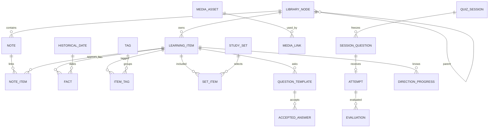

# Модель данных

Статус: согласованная логическая модель. Физическая схема v1 реализована в src/infrastructure/storage/database.ts; отличия и текущий статус описаны в implementation-status.md. Основание — утверждённая Product Specification 1.0. Основной источник истины — локальная SQLite.

## 1. Общие правила

- Идентификаторы сущностей — стабильные UUID; пути к файлам и заголовки не являются ID.
- Моменты времени сохраняются в UTC; интерфейс и календарь активности используют локальный часовой пояс ПК. Исторические даты имеют отдельную модель и не сохраняются как JavaScript Date.
- Поддерживаются версии схемы, содержимого объектов, типов заданий, политики проверки и формулы прогресса.
- Нормализованные связи и типизированные значения хранятся явно. JSON используется для документов редактора, схем расширений, настроек и неизменяемых снимков, а не вместо всех отношений.
- Для JSON есть версия структуры и runtime-валидация. Неизвестные версии не угадываются и не переписываются автоматически.
- Удаление материала из активной библиотеки не каскадно уничтожает историю ответов. История содержит снимки и не зависит от существования исходной карточки.

## 2. Основные связи

Диаграмма показывает основные связи. Снимки вопроса сохраняются даже при последующем удалении или изменении исходного объекта и шаблона.

## 3. Библиотека и конспекты

| Сущность | Основные поля | Назначение и ограничения |
| --- | --- | --- |
| `library_nodes` | id, parent_id, kind, title, sort_order, created_at, updated_at | Дерево разделов, периодов и тем; kind = section/period/topic; запрет циклов и недопустимого родителя |
| `notes` | id, topic_id, title, document_json, document_version, revision, timestamps | Конспект в теме; документ редактора, а не произвольный исполняемый HTML |
| `learning_items` | id, type_key, type_version, topic_id, title, summary, revision, timestamps, deleted_at | Основной учебный объект; основная тема позволяет однозначно выполнить «переместить» |
| `note_items` | note_id, item_id, position | Ссылки конспектов на объекты без дублирования самих объектов; уникальная пара |
| `tags` / `item_tags` | id/name; item_id/tag_id | Много тегов на объект; уникальность нормализованного имени и пары связей |
| `study_sets` / `set_items` | id/title; set_id/item_id | Пользовательские наборы, независимые от дерева и тегов |
| `item_relations` | id, from_item_id, relation_key, to_item_id, source_id | Связи «участвует», «автор», «реформа правителя», «причина», «следствие» и другие зарегистрированные отношения |

Одно произведение культуры и его автор могут быть самостоятельными объектами со связью, а не повторяющимися строками. Одна личность может иметь несколько периодов правления: интервалы не объединяются в ложный непрерывный период.

Типы материала задаются внутренними версионированными определениями: доступные факты, их типы и кратность, подписи форм и допустимые шаблоны вопросов. Добавление нового типа не требует превращать все объекты в пару `date/event`.

## 4. Типизированные факты и источники

`facts`:

- `id`, `item_id`, `field_key`, `position`, `value_kind`;
- одно значение: текст, ссылка на историческую дату, ссылка на другой объект, ссылка на медиа или версионированное структурированное значение;
- `source_id`, необязательное примечание;
- ограничение: тип и число значений соответствуют определению поля; одновременно заполненные несовместимые значения не принимаются.

Примеры полей: дата события, период правления, определение термина, автор произведения, место, описание источника. Значимые для поиска и сортировки даты и связи не прячутся в произвольном описании.

`sources`: id, title, author/publisher при наличии, URL или библиографическое описание, дата обращения, локальный комментарий. `fact_sources` при необходимости связывает факт с несколькими источниками.

`content_packages` и `content_package_entries` фиксируют версию начального исторического набора, перечень включённых объектов, источники и состояние проверки. Повторная загрузка пакета не дублирует записи и не перезаписывает пользовательские правки молча. Реальные данные и developer fixtures не смешиваются.

## 5. Исторические даты

### Структура

`historical_dates` содержит:

| Поле | Смысл |
| --- | --- |
| id | Идентификатор значения |
| kind | year/day/range/century/century_part |
| calendar | source_unspecified/julian/gregorian; календарь источника без автоматического пересчёта |
| qualifier | exact/approximate |
| start, end | Структурированные границы; end для диапазона |
| century, century_part | Номер века и half/quarter с номером части, если этот вид выбран |
| original_label | Исходная запись для прослеживаемости |
| value_version | Версия структуры |
| sort_lower, sort_upper, sort_precision | Производные ключи сортировки; не эталон ответа |

Компонент границы: `era` = CE/BCE, положительный `year`, необязательные `month` и `day`, `precision` = year/day. В пользовательском историческом представлении нулевого года нет. Эра не определяется догадкой по знаку свободного текста.

Ключи сортировки учитывают направление лет до нашей эры и интервал века. Приблизительные значения и даты с неопределённым календарём не превращаются в выдуманный точный день. Для календарей без пересчёта сортировка по компонентам не заявляется точным астрономическим сравнением дней между разными календарями.

### Примеры нормализации

| Ввод | Значение |
| --- | --- |
| `1380` | Год 1380, CE, точность year |
| `08.09.1380`, `8 сентября 1380` | Одно значение day: 1380-09-08; стиль календаря определяется данными источника |
| `1237–1241` | Диапазон годов с двумя границами |
| `XIII век` | Век 13; производный диапазон годов 1201–1300 |
| `вторая половина XV века` | Век 15, половина 2; производный диапазон 1451–1500 |
| `около 980 года` | Год 980 с qualifier approximate; скрытый допуск отсутствует |
| `44 до н. э.` | Год 44 BCE, без преобразования в JS Date |

Сортировочный диапазон века не делает его ответом, эквивалентным любому году этого века. «Около» не получает автоматически ±5 или ±10 лет. Политика задания может явно задавать допустимый диапазон или альтернативы.

## 6. Шаблоны вопросов и допустимые ответы

| Сущность | Основные поля | Правило |
| --- | --- | --- |
| `question_templates` | id, item_id, type_key/version, direction_key, prompt_spec, answer_spec, validation_policy, enabled, revision | Способ спросить об объекте; промпт и эталон могут ссылаться на его факты |
| `accepted_answers` | id, template_id, answer_kind, value, normalized_value, provenance | Явно допустимые формулировки и структурированные ответы; нормализация не стирает смысл |
| `rubric_criteria` | id, template_id, criterion_key, text, accepted_variants, required | Критерии развёрнутого ответа; неполные правила не дают гарантированной автоматической оценки |

`direction_key` отделяет знания по направлениям: event_to_date, date_to_event, ruler_to_reign и другие. Несколько изображений/вариантов одного направления не создают ему несколько голосов в среднем объекта. Состав включённых направлений хранится явно.

Политика проверки содержит версии нормализации, разрешённые формы даты, допустимые альтернативы, явный диапазон при необходимости и режим self/automatic_with_review. Для дат балл 0,5 за верный год при ожидаемом дне — согласованное правило. Другие случаи частичного балла не придумываются по произвольному числу совпавших слов.

## 7. Медиа

`media_assets`: id, sha256, relative_path, detected_mime, byte_size, width, height, original_filename, title, source_id, imported_at, decoder_version.

Оригинал неизменяемый. Замена изображения создаёт/выбирает другой ассет и меняет связь, а не перезаписывает байты, на которые ссылаются исторические снимки. `relative_path` не выходит за каталог поколения; абсолютные пути исходных файлов не являются способом доступа к изображению.

Связи:

- `item_media`: item_id, asset_id, role, position, caption;
- `note_media`: note_id, asset_id, document_reference;
- `rank_media`: rank_id, asset_id;
- `session_question_media`: session_question_id, asset_id, role;
- миниатюры — пересоздаваемый кэш по хешу оригинала и версии преобразования.

Все ссылки на медиа, включая снимки теста и портреты, участвуют в проверке целостности и в определении, можно ли удалить оригинал. Для диаграммы выше эти связи обобщены как MEDIA_LINK; физически используются явные таблицы с внешними ключами.

## 8. Сессии, вопросы и попытки

### Сессия

`quiz_sessions`: id, mode, config_version, selection_snapshot, random_seed, status, created_at, started_at, finished_at, reviewed_at.

Конфигурация хранит фактический отбор, направления и порядок вопросов. Seed помогает воспроизвести выбор, но не заменяет сохранённые снимки. Варианты ответа выбираются из реального материала; нехватка подходящих вариантов — ошибка подготовки задания.

### Вопрос сессии

`session_questions`: id, session_id, ordinal, source_item_id, source_template_id, item_revision, question_type/version, direction_key, topic_snapshot, prompt_snapshot, expected_answer_snapshot, alternatives_snapshot, policy_snapshot, response_schema, media_snapshot.

Ограничение: уникальные `(session_id, ordinal)`. Изменение объекта, его темы или допустимых ответов после старта не меняет уже заданный вопрос. Эталон и политика не выдаются renderer до итогового разбора.

### Окончательный ответ

`attempts`: id, session_question_id, command_id, raw_answer, parsed_answer, submitted_at, sequence_no.

Одна окончательная попытка на вопрос сессии; повторная проверка материала создаёт новый вопрос в другой сессии. Уникальные `session_question_id` и `command_id` защищают от двойного Enter/повторной доставки. Состояние «Вы уверены?» — ещё не попытка.

### Оценка

`evaluations`: id, attempt_id, revision, outcome, half_units, reason_code, explanation, method, policy_version, evaluated_at, evaluation_sequence, supersedes_id.

- outcome: correct/partial/incorrect/needs_review;
- half_units: 2/1/0; у needs_review — NULL;
- method: automatic/self/manual_review;
- ограничение: исход и балл согласованы, ревизии уникальны, действующая оценка однозначна.

История оценки не маскирует автоматическую проверку под ручную. Если оценку требуется пересмотреть, сохраняется новая ревизия и основание; старый финальный текст ответа не редактируется. Изменение алгоритма не переписывает прошлые оценки без явной процедуры.

Итоговый разбор отличает ошибочные, частичные и ожидающие оценки ответы. Для статистики используются только действующие числовые оценки; ожидающие отражаются отдельным количеством.

## 9. Прогресс

Формула без двоичной погрешности: сумма half_units последних 20 оценённых проверок направления / 40 × 100%. Каждая единица half_units соответствует 2,5 процентного пункта.

Оценённые проверки упорядочиваются по монотонному `evaluation_sequence` применения оценки; `submitted_at` также сохраняется для истории. Так отложенная самопроверка становится проверкой знания при оценивании, а не получает выдуманный балл при отправке. Ревизия уже применённой оценки заменяет исходный результат в его позиции, а не считается дополнительной проверкой.

`direction_progress`: item_id, direction_key, enabled, graded_count_total, window_half_units, window_attempt_ids, current_percent, latest_graded_at, algorithm_version, projection_revision.

Ключ `(item_id, direction_key)` уникален. Проекция пересчитывается из действующих оценок. Сумма окна ограничена 0–40; полный счётчик может быть больше 20. Полный список попыток не обрезается.

`progress_events`: id, evaluation_id, item_id, direction_key, direction_before/after, item_before/after, applied_at, algorithm_version. Это снимки изменения, показанного при применении оценки; текущая проекция может отличаться после добавления новых направлений или материалов.

Правила агрегирования:

1. Среднее по включённым направлениям объекта, каждое с одинаковым весом. Непроверенное направление — 0%, без фиктивных попыток.
2. Среднее по активным объектам области, каждый объект имеет одинаковый вес. Теги и наборы не размножают объект.
3. Среднее тем без весов не используется для общего результата. Пустая область имеет состояние «нет данных».
4. Изменение охвата библиотеки может менять общий процент без новой попытки; это не записывается как ошибка ответа.
5. Порог уровня применяется до округления отображения. 96,99% не становится «Элитно» из-за округления до 97%.

## 10. Аналитика и ранги

Основные показатели получаются из попыток, действующих оценок и текущих проекций. Активность группируется по локальным дням из UTC-моментов, без отдельного анализа длительности ответа.

Доля полностью правильных ответов и показатель знания различаются. Частичные ответы и ожидающие самопроверки представлены отдельно, не скрываются в числе полностью правильных или ошибочных.

`rank_definitions`: id, key, title, lower_bound, upper_bound, sort_order, description. `rank_media` связывает ранг с проверенным локальным портретом. Диапазоны не пересекаются и покрывают 0–100; верхняя граница последнего диапазона включительна.

Названия и границы уровней знания и рангов берутся из утверждённой спецификации. Справочник персонажей не заменяет историю знаний и не хранит фиктивный «IQ».

## 11. Служебные данные

| Сущность | Назначение |
| --- | --- |
| `settings` | Версионированные настройки приложения; содержательные параметры входят в backup |
| `schema_migrations` | Номер миграции, контрольная сумма, время успешного применения |
| `import_batches` / `import_rows` | Предварительные результаты, ошибки строк, состояние подтверждения, ссылки на созданные записи |
| `file_operations` | Стадии незавершённых операций с ассетами; восстановление после прерывания |
| `backup_runs` | Состояние и результат операций backup; история операции не является самой резервной копией |
| `media_diagnostics` | Результаты последней проверки; не основание считать файл исправным навсегда |

В ZIP-манифесте отдельно указаны версия формата, версия схемы SQLite, версия приложения, время, размеры и хеши файлов. Будущие несовместимые версии отклоняются до замены базы.

## 12. Ограничения, индексы и транзакции

- Внешние ключи включены на каждом соединении; намеренные удаления не должны случайно каскадировать в историю.
- Индексы: дерево по parent_id/sort_order; объекты по topic_id/type/deleted_at; даты по нормализованным границам; связи по обоим концам; попытки по вопросу и времени; оценки по attempt_id и sequence; прогресс по объекту/направлению.
- Текстовый индекс FTS5 хранит нормализованные заголовки, описания и доступный текст конспектов. Русская нормализация Ё/Е явная; морфологический поиск не обещается без отдельной реализации.
- Создание объекта с фактами и связями — одна транзакция. Подтверждение импортируемой группы — транзакция с проверкой выбранных строк. Ответ, оценка и изменение проекции — согласованная транзакция; повторы идемпотентны.
- Изображение сначала сохраняется и проверяется на диске, затем создаются ссылки в транзакции. Backup и очистка используют согласованные ограничения на удаление.
- Тяжёлые списки постраничные; UI не загружает всю историю и все оригинальные изображения сразу.
- Отдельные тесты должны проверить нарушения ограничений, сбой транзакции, повтор команды, восстановление после прерывания и пересчёт проекций по истории.
